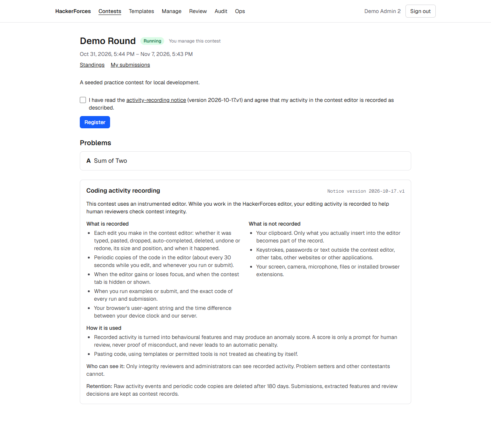
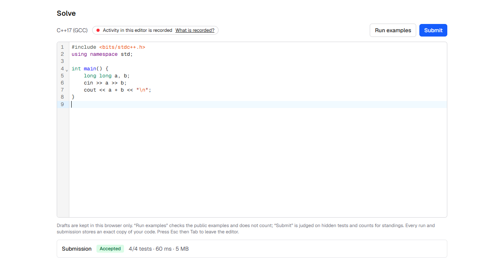
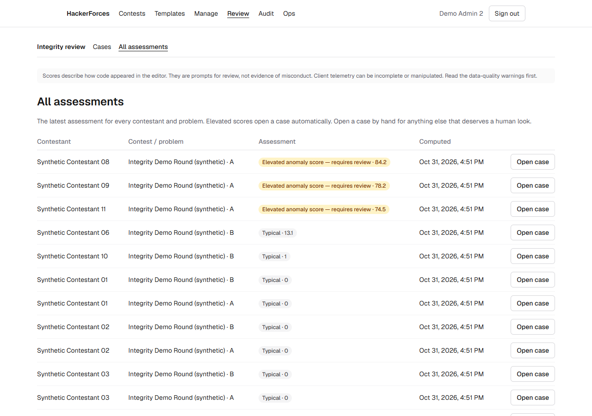
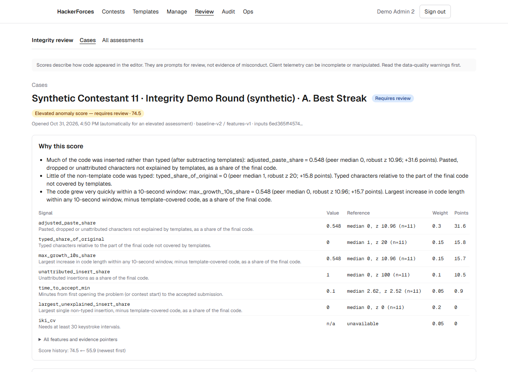
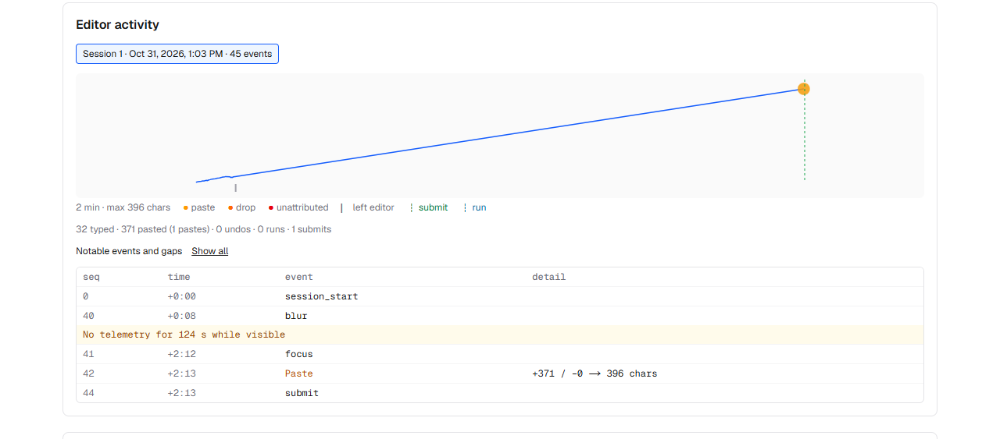
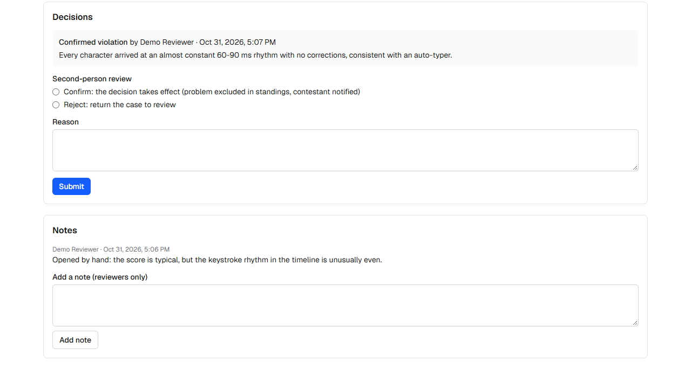
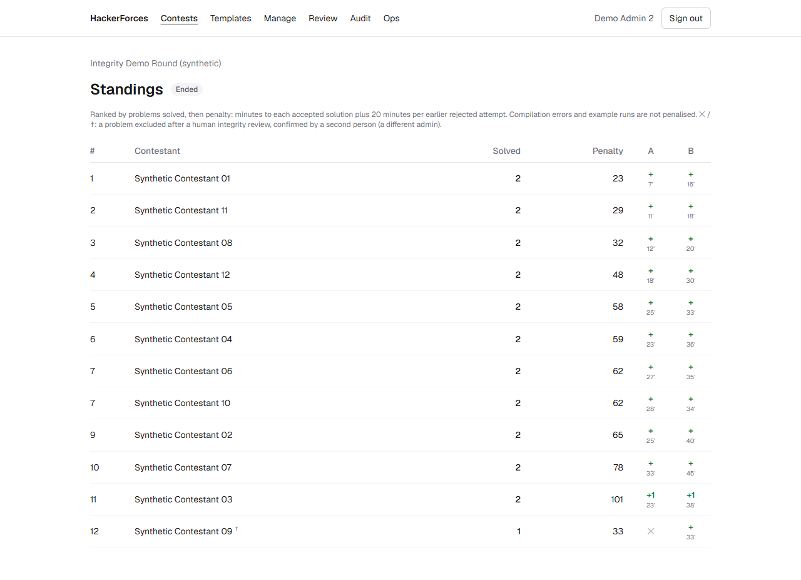

# HackerForces

A competitive programming platform with an instrumented browser IDE and a
transparent, human-in-the-loop behavioural anomaly review system.

> Anomaly scores are review aids, not proof of misconduct. Nothing in this
> system penalises a contestant automatically.

## Walkthrough

Contestants accept a versioned notice that says what the editor records, and what it
does not, before they can register:



They solve problems in a C++17 editor that shows, at all times, that activity is recorded.
Code is judged on an isolated Judge0 VM, never inside the web app:



Reviewers see one assessment per contestant and problem. Elevated scores open a case
automatically:



A case puts data-quality warnings first, then explains the score signal by signal against
the contest cohort:



The editor timeline shows how the code appeared, here two minutes away from the editor
followed by one large paste:



A "confirmed violation" takes effect only after a different admin confirms it:



Only then is the problem excluded in standings, and the contestant gets a neutral notice
with the rationale and can respond in writing:



The contestants, timelines and decisions in these screenshots are **synthetic**
(`npm run seed:demo`). [docs/demo.md](docs/demo.md) is a ten-minute demo script that
uses the same data.

## Documentation

- Architecture and deployment boundary: [docs/architecture.md](docs/architecture.md)
- Integrity signals, scoring and review: [docs/integrity.md](docs/integrity.md)
- Evaluation on synthetic data, including what it misses: [docs/evaluation.md](docs/evaluation.md)
- Judge isolation and threat model: [docs/judge.md](docs/judge.md)
- Deploying to Vercel: [docs/deployment.md](docs/deployment.md)
- Demo script: [docs/demo.md](docs/demo.md)
- Roadmap and acceptance criteria: [docs/roadmap.md](docs/roadmap.md)

## Stack

Next.js 16 (App Router) · TypeScript (strict) · Tailwind CSS 4 · Drizzle ORM ·
PostgreSQL (Neon) · Better Auth · Zod · Vitest + PGlite. The app deploys to
Vercel as a single project.

## Local development

Requires Node.js 22 or later.

1. Install dependencies:
   ```bash
   npm install
   ```
2. Create a **dev branch** in your Neon project and copy its *pooled* connection string.
3. Create `.env.local` from `.env.example`, then fill in `DATABASE_URL` and a random `BETTER_AUTH_SECRET`.
4. Apply migrations:
   ```bash
   npm run db:migrate
   ```
5. Start the app:
   ```bash
   npm run dev
   ```
   Then open http://localhost:3000 and create an account.
6. Make yourself an admin:
   ```bash
   npm run grant-role -- you@example.com admin
   ```
7. Optionally, seed demo data. First set `SEED_DEMO_PASSWORD` in `.env.local`, then run:
   ```bash
   npm run seed
   ```
   This creates `setter@demo.test`, `reviewer@demo.test`, `admin@demo.test` and `contestant@demo.test`, plus a published "Demo Round" contest that starts one minute after seeding. Running it again is safe.
8. Optionally, add a finished contest with **synthetic** integrity data for demos (after step 7):
   ```bash
   npm run seed:demo
   ```
   Twelve synthetic contestants (`synthetic-01@demo.test` … `synthetic-12@demo.test`, same password) play labelled scenarios through the real telemetry, judging (mock judge) and scoring code. The review queue then has cases in every state: open, awaiting the second confirmation, closed as inconclusive, and a confirmed violation with the contestant's response. Everything in "Integrity Demo Round (synthetic)" is simulated. It is created once; to rebuild it, use a fresh dev branch. Never run either seed against production.

## Checks

The test suite runs against an in-process Postgres (PGlite) and needs no database, Docker, or `.env`.

```bash
npm run check
```

```bash
npm run build
```

## Evaluation on synthetic data

The evaluation runs offline and is not part of the deployed app. It needs Python 3.12 or later.

1. Create the virtual environment:
   ```bash
   python -m venv ml/.venv
   ```
2. Install the pinned dependencies. On Windows:
   ```bash
   ml/.venv/Scripts/python -m pip install -r ml/requirements.txt
   ```
   On macOS or Linux:
   ```bash
   ml/.venv/bin/python -m pip install -r ml/requirements.txt
   ```
3. Generate the dataset, then evaluate and write `docs/evaluation.md`:
   ```bash
   npm run eval
   ```
4. Run the Python tests:
   ```bash
   npm run eval:test
   ```

All of the evaluation data is **synthetic**. See [docs/evaluation.md](docs/evaluation.md) for what the results do and do not mean.

## Deploying to Vercel

See [docs/deployment.md](docs/deployment.md) for environment variables, migrations, crons and the post-deploy smoke test. See [docs/judge.md](docs/judge.md) for setting up the isolated Judge0 VM and its threat model. The app stays on the safe mock judge until a judge VM has been provisioned and verified.
